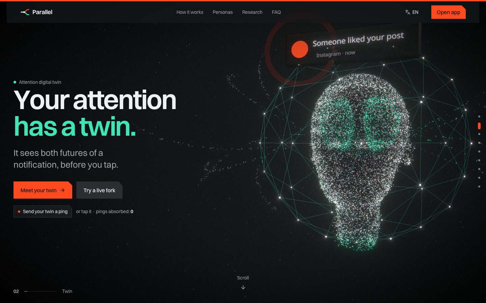
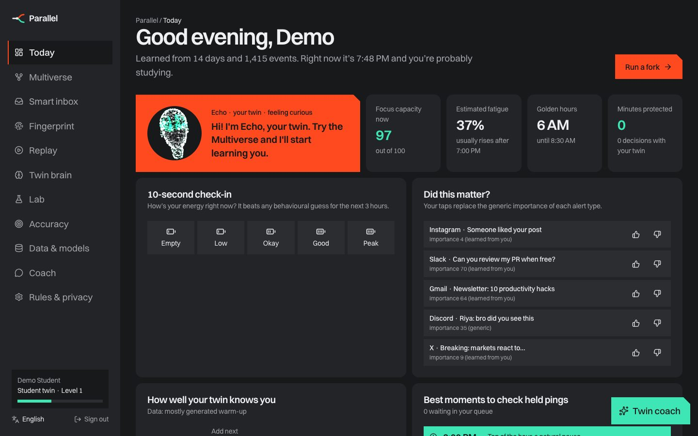
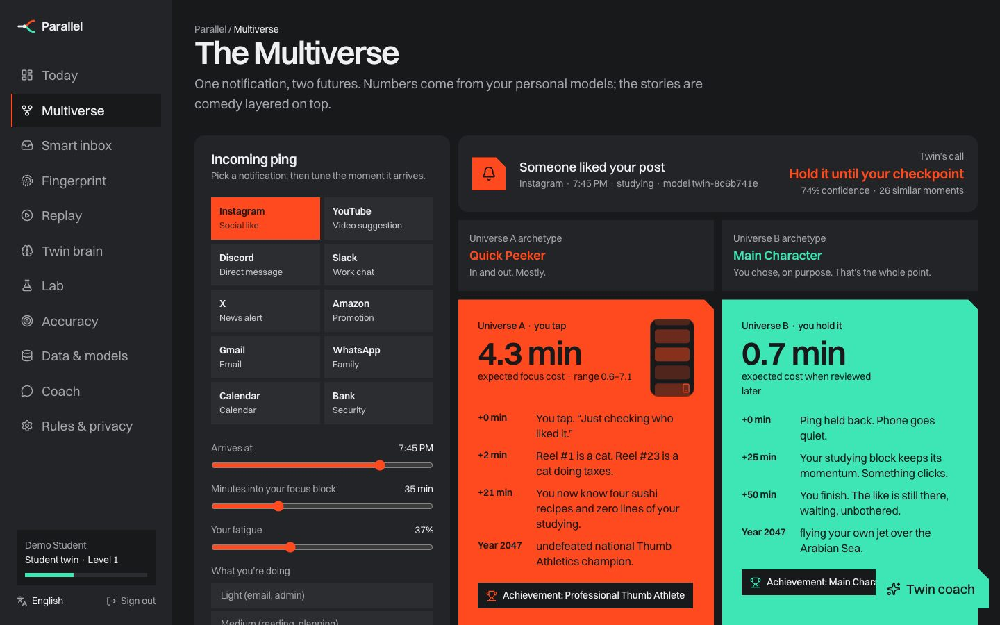
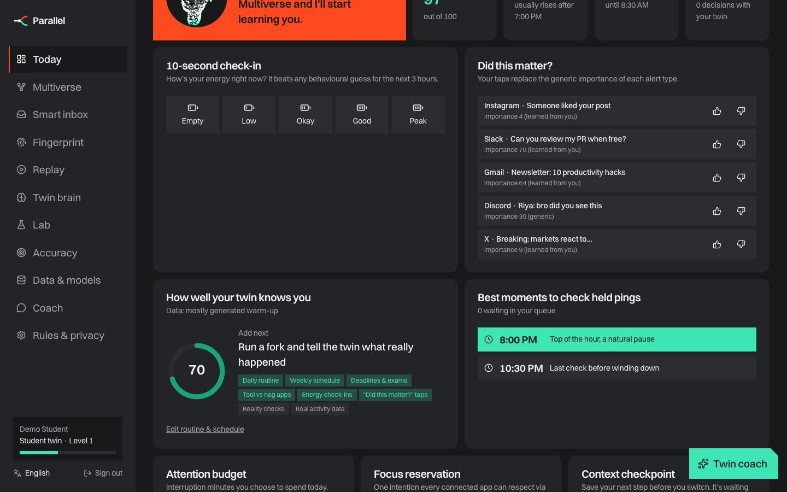
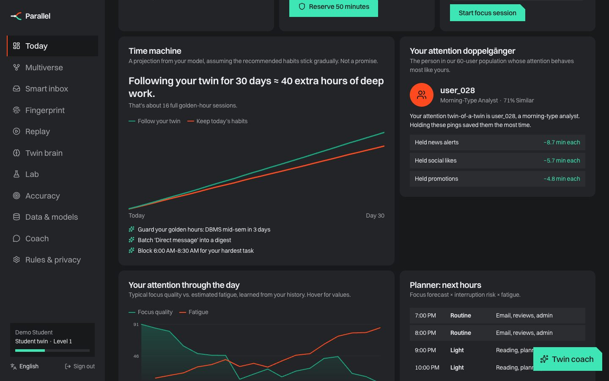
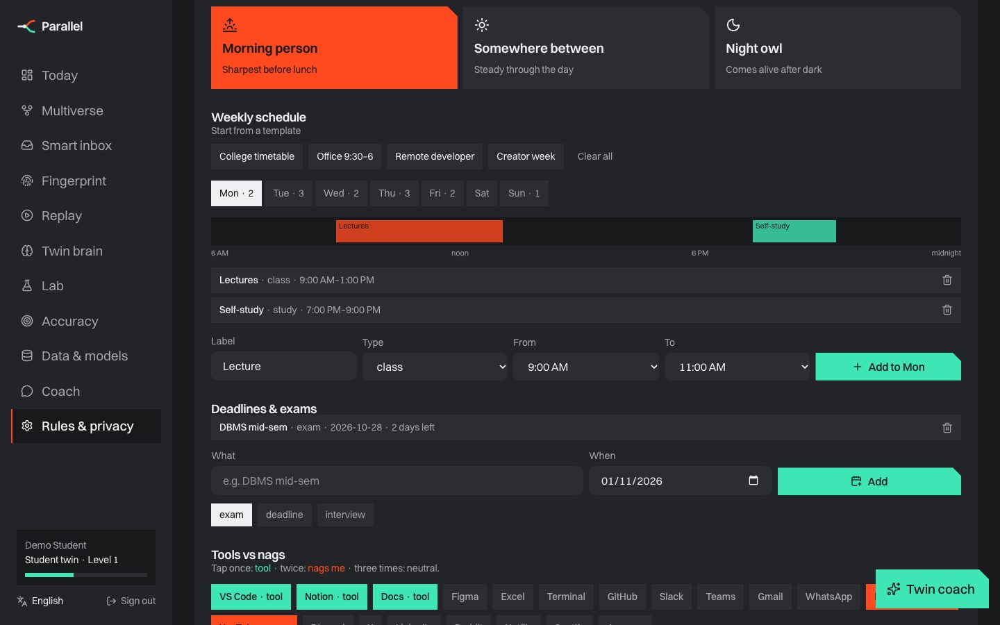
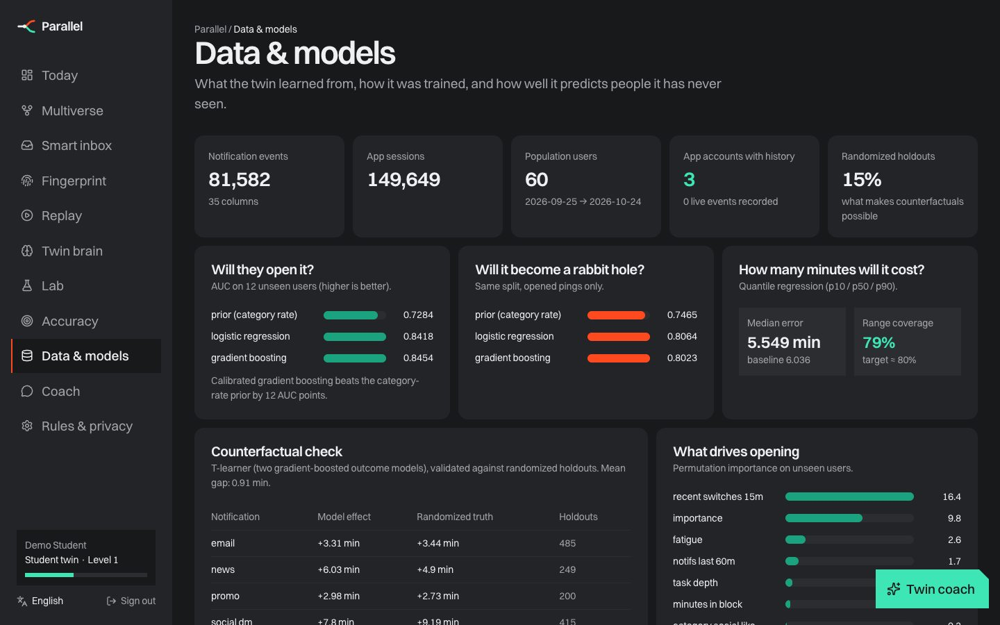
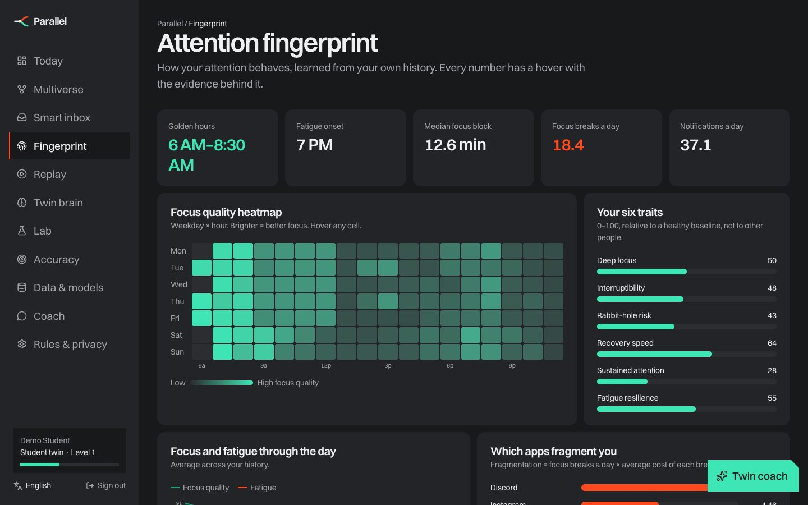
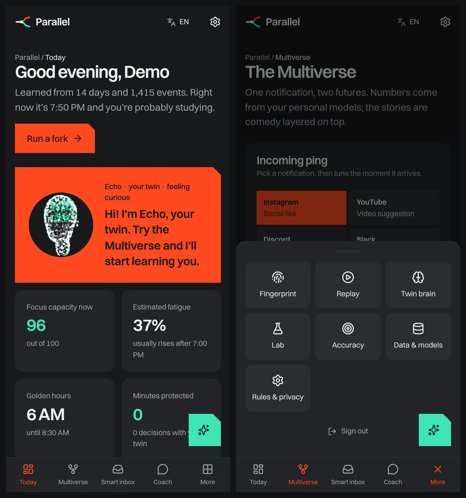

<div align="center">

# Parallel

### Your attention digital twin

**Every ping forks your day. Parallel shows you both futures before you tap.**

Built for **CASCADE ’26 · Theme 3 · Problem 3: The Attention Digital Twin**

[Run it](RUN.md) · [Architecture](docs/ARCHITECTURE.md) · [Data & ML](docs/DATA_AND_ML.md) · [Mobile app](docs/MOBILE.md) · [API](docs/API.md) · [Presenter guide](docs/PRESENTER_GUIDE.md) · [Project report (Word)](docs/Parallel_Project_Report.docx)



</div>

---

## The problem in one example

You're coding. *“Someone liked your post.”*

| Universe A: you allow it | Universe B: your twin holds it |
|---|---|
| +2 min interruption → Instagram opened → +17 min browsing → +8 min to regain focus = **27 focus-minutes gone** | Held until your next checkpoint, read in a digest = **~0.7 min** |

Everyone's attention is different. The same like can cost one person 2 minutes and another 40. Parallel learns *you*, predicts the downstream chain of every notification with a range and a confidence, compares it with the counterfactual, and checks itself against what really happened.

## What it does

### The twin learns everything the problem statement asks for
| The twin learns… | How | Where you see it |
|---|---|---|
| When you focus best | Focus quality by weekday × hour, shifted by your declared wake/bed time and chronotype | Fingerprint heatmap, 3D ring, golden hours |
| What causes interruptions | Calibrated p(open \| context): task depth, fatigue, time, sender, recent switches | Multiverse “why” factors, Twin brain |
| Which content causes prolonged sessions | p(rabbit hole) plus dwell-time models per app/category | Fragmentation bars, Replay |
| Which notifications matter | Your “did this matter?” taps, rules and randomized uplift per category | Smart inbox, Today |
| When you're fatigued | Behavioural estimate plus your 10-second energy check-ins | Today, planner, coach |
| Which apps fragment you | Breaks per day × cost per break; your tool vs nag apps | Fingerprint, attention debt |
| “If I allow this now?” + counterfactual | 2,000 Monte Carlo futures; randomized holdouts; T-learner | **Multiverse** (hero feature) |

### What are personas?
A **persona is the twin's starting guess about you**. On day one it has no history, so it borrows the typical pattern of your kind of busy, then moves towards *you* as your own data arrives (its personal weight grows as n/(n+20)).

| Persona | Starting focus peaks | Work tools | Most frequent pings | Fatigue usually from |
|---|---|---|---|---|
| Student | 10 AM and 9:30 PM | Notion, Docs, lectures | Social likes, DMs | 4 PM |
| Developer | 11 AM and 11 PM | VS Code, Terminal, GitHub | Work chat, email, news | 4:30 PM |
| Creator | 2 PM and 8 PM | Figma, Docs, Notion | Social likes (their feed is also their work) | 6 PM |
| Professional | 9:30 AM and 3 PM | Excel, Docs, Notion | Work chat, email, meetings | 3 PM |

Your declared routine (wake/bed, chronotype, schedule) shifts these immediately, and the four demo logins are one account per persona.

### It knows your day
- **7-step onboarding:**
  - persona and goals
  - wake/bed time and chronotype
  - **weekly schedule editor** with templates
  - **deadlines and exams**
  - which apps are **tools** and which **nag** you
  - who always gets through

  The schedule and deadline steps can be skipped, and the same editor lives in Settings.
- **Schedule-aware decisions.** During a class or work block, low-value pings are held and the reason names the block (“You're in Lectures until 1:00 PM…”). A close deadline makes the twin stricter and adds a “guard your golden hours” recommendation. The focus curve, day-0 history, planner and recommendations all follow your schedule.
- **Ongoing inputs on Today:**
  - a 10-second energy check-in
  - “did this matter?” taps that replace the generic importance of each alert type
  - a meter showing how well the twin knows you and what to add next
  - the **best moments to check held pings**, based on when your blocks end

### Features that go further
- **Multiverse simulator:** what-if sliders, two comic universes over grounded numbers, a cost distribution, explanations, personal vs population vs blended predictions, and a reality check that grades every prediction.
- **Smart inbox:** live triage, a deferred queue and digest, and **auto-reply drafts** (“I'm in Lectures until 1 PM…”) in four languages, never sent automatically.
- **Time machine:** 30 simulated days, current habits vs following your twin.
- **Attention doppelgänger:** your closest behavioural match among 60 people, and what worked for them.
- **Abstention:** when the evidence is thin, the twin asks instead of deciding.
- **Accuracy center + Data & models:**
  - calibration and comparison with a generic rule
  - drift (PSI), data quality and a model registry
  - dataset preview
  - hash-chained audit log
- **Twin brain:** an explorable knowledge graph of tasks, times, triggers, apps and outcomes.
- **Coach:** voice and text in **English, हिन्दी, मराठी, Español**. It is persona-aware and every number comes from the models.
- **Lab:**
  - attention budget and debt
  - co-focus rooms
  - habit experiments
  - developer **Attention API** + JS SDK
  - team health (aggregates only, k ≥ 5)
- **Gamification without guilt:** XP for intentional choices, anti-farming rules, quests validated against real activity, streaks with forgiveness.
- **Privacy:**
  - metadata only; message text and window titles are never stored
  - pause learning and set a retention window
  - export, portable profile, delete

### Mobile-ready
One React codebase ships as a website, an **installable PWA**, and native **Android and iOS** apps through Capacitor (`frontend/android`, `frontend/ios`). Phones get a tab bar with a More sheet, safe areas, haptics and local reminders. See **[docs/MOBILE.md](docs/MOBILE.md)**.

## Screenshots
| | |
|---|---|
|  |  |
| **Today:** Echo the 3D companion, live state, inputs | **Multiverse:** one ping, two futures |
|  |  |
| **Check-in, “did this matter?”, knowledge meter, check moments** | **Time machine and doppelgänger** |
|  |  |
| **Weekly schedule, deadlines, tool vs nag apps** | **Dataset, models vs baselines, registry** |
|  |  |
| **Attention fingerprint** | **Phone layout** |

## Data & ML (honest version)
- `python -m ml.dataset` creates a **synthetic** population: 60 users × 30 days, **81,582 notification events × 35 columns** and 149,649 app sessions. It is saved as CSVs and SQLite tables.
- `python -m ml.train` trains population models on **users never seen in training**:

| Target | Model | Unseen-user result | Baseline |
|---|---|---|---|
| p(open) | Gradient boosting + isotonic | **AUC 0.845** | 0.728 |
| p(rabbit hole) | Gradient boosting + isotonic | **AUC 0.802** | — |
| Focus cost p10–p90 | Quantile GBMs | **79% coverage**, MAE 5.5 min | MAE 6.0 |
| Counterfactual | T-learner | **0.9 min** gap vs randomized truth | — |

- Every account's history lives in SQLite (`user_segments`, `user_notifications`). Real events (`source='live'`) are appended, and the twin refits from the database.
- Details: **[docs/DATA_AND_ML.md](docs/DATA_AND_ML.md)**.

## Quick start
```bash
git clone https://github.com/SDP42/parallel.git
cd parallel
./run.sh
```
On Windows, run `powershell -ExecutionPolicy Bypass -File .\run.ps1` instead of `./run.sh`. Then open **http://localhost:5180**.

| Demo login | Password |
|---|---|
| student@parallel.app · developer@parallel.app · creator@parallel.app · professional@parallel.app | `parallel123` |

Each demo account comes with a persona-appropriate routine, schedule and upcoming deadline. Full instructions for Mac, Windows and phones are in **[RUN.md](RUN.md)**.

## Architecture
```
React 19 (web · PWA · Capacitor Android/iOS) ──HTTPS/JWT──▶ FastAPI ──▶ SQLite
   3D landing (R3F + GLSL) · 12 app screens       twin.py · routine.py · population.py     users · profiles · history
   i18n (4 languages) · voice coach                routine_api · platform_api · assistant   predictions · audit chain
                                                    ▲ versioned models (ml/train.py)         ds_* population dataset
```
Full diagram and request flow: **[docs/ARCHITECTURE.md](docs/ARCHITECTURE.md)**.

## Repository map
```
parallel/
├─ README.md · RUN.md · CHANGELOG.md · CONTRIBUTING.md · run.sh · run.ps1
├─ docs/
│  ├─ ARCHITECTURE.md · DATA_AND_ML.md · MOBILE.md · API.md · FEATURES.md · ROADMAP.md
│  ├─ IDEATION.md · PRESENTER_GUIDE.md · Parallel_Project_Report.docx
│  └─ screenshots/
├─ sdk/parallel-sdk.js                 Attention API client
├─ backend/
│  ├─ app/   main · twin · routine · routine_api · platform_api · population · history · synth · assistant · gamify
│  ├─ ml/    dataset.py · train.py
│  └─ tests/ test_api.py
└─ frontend/
   ├─ src/landing/   TwinWorld (WebGL world) · shapes · scroll
   ├─ src/pages/     Landing · Auth · Onboarding (7 steps) · Privacy · Contact · NotFound
   ├─ src/app/       Today · Multiverse · Inbox · Fingerprint · Replay · Brain · Lab · Accuracy · Data & models · Coach · Settings
   ├─ src/components RoutineEditor · Universes · VoiceCoach · charts · React Bits
   ├─ android/ · ios/   Capacitor native projects
   └─ public/        PWA manifest, service worker, icons, robots, sitemap, OG image
```

## Build on it
Start with **[docs/ROADMAP.md](docs/ROADMAP.md)**, which says where to add endpoints, rules, models, pages, languages and native features, and **[CONTRIBUTING.md](CONTRIBUTING.md)**. The next big steps are the Android notification-listener plugin, an ActivityWatch bridge script and calendar import.

## Honest limits
- **Day-0 history is still generated.** It follows your declared routine, but it is not behaviour you actually showed. The Settings page says so, and real data replaces it as it arrives.
- **Accuracy numbers are on synthetic data.** The best demo upgrade is a few days of your own ActivityWatch data (`POST /api/ingest/activitywatch?tz_offset_min=330`; ActivityWatch times are UTC, and 330 is the offset for IST).
- iOS doesn't let apps read other apps' notifications. Android and desktop are the realistic first platforms (`GET /api/platform/capabilities`).
- Fatigue is a behavioural estimate, never a medical claim.
